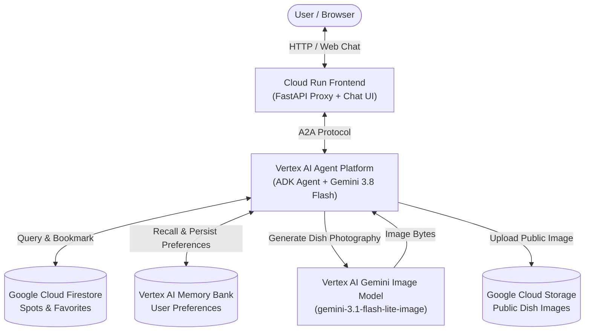

<p align="center">
  
</p>

# 🍛 Hyderabad Food Trail Guide

> Discover biryani, haleem & Irani chai across Hyderabad with an AI agent.


---

### Why I built this

Hyderabad's culinary legacy spans centuries—from royal Nizami biryanis in the Old City to bustling late-night chai joints across the city. Finding authentic spots tailored to individual tastes, dietary choices, and neighborhoods can be overwhelming. I built this agent to act as a knowledgeable local culinary companion that curates authentic food trails, captures dishes visually, and remembers user preferences across visits.

---

### ✨ Features

- **🔍 Firestore Food Spot Search**: Searches curated eateries by neighborhood (`Old City`, `Banjara Hills`, `Gachibowli`, `Ameerpet`), dish query (`biryani`, `haleem`, `dosa`, `chai`), and dietary filter (`veg` / `non-veg`).
- **🔖 Save & List Favorites**: Bookmarks beloved eateries with personalized notes to Firestore (`user_favorites`) and lists them on demand.
- **🧠 Cross-Session Long-Term Memory**: Powered by Vertex AI Memory Bank and `PreloadMemoryTool` to remember user preferences (spice tolerance, dietary constraints, budget, favored areas) across chats.
- **🎨 AI Dish Photography**: Generates dish imagery with `gemini-3.1-flash-lite-image` on Vertex AI, saves session artifacts, and uploads public images to Cloud Storage.
- **🗺️ Food Trail Planning**: Synthesizes 2–3 stop neighborhood food trails (e.g. morning chai and biscuits, afternoon biryani, evening dessert).
- **💻 Custom Cloud Run Web UI**: Dedicated responsive chat interface with Markdown formatting (`marked.js`), sanitized rendering (`DOMPurify`), automatic inline Cloud Storage image previews, and quick-prompt chips.

---

### 🏗️ Architecture



---

### 🧰 Tech Stack

| Component | Technology |
|---|---|
| **Agent Framework** | Google Agent Development Kit (ADK) |
| **Foundation Model** | Gemini 3.8 Flash (`gemini-3.8-flash`) |
| **Image Generation** | `gemini-3.1-flash-lite-image` via Google GenAI SDK |
| **Agent Runtime** | Vertex AI Agent Platform (Agent Runtime / Reasoning Engine) |
| **Agent Protocol** | A2A (Agent-to-Agent) |
| **Database** | Google Cloud Firestore (Native Mode) |
| **Media Storage** | Google Cloud Storage (Public bucket) |
| **Long-Term Memory** | Vertex AI Memory Bank (`VertexAiMemoryBankService`) |
| **Frontend & Proxy** | FastAPI, Uvicorn, Vanilla JS, CSS3, `marked.js`, `DOMPurify` |
| **Frontend Hosting** | Google Cloud Run (Containerized) |
| **Tooling & CLI** | `uv`, `agents-cli`, `gcloud` CLI |

---

### 💬 Try these prompts

1. *"Which biryani places do you know in Old City?"*
2. *"Where can I get authentic Irani chai and Osmania biscuits?"*
3. *"Plan a 3-stop food trail in Banjara Hills for dinner."*
4. *"Save Hotel Shadab to my favorites with a note to try their mutton biryani."*
5. *"Generate an image of Hyderabadi biryani."*

---

### 🚀 Run it yourself

#### Prerequisites
- Python 3.11+
- [`uv`](https://docs.astral.sh/uv/) package manager
- [`agents-cli`](https://pypi.org/project/google-agents-cli/)
- Google Cloud project with Firestore, Vertex AI, and Cloud Storage enabled
- Authenticated `gcloud` CLI (`gcloud auth login` and `gcloud auth application-default login`)

#### Setup Steps

1. **Clone and install dependencies**:
   ```bash
   git clone https://github.com/sameer-sde/buildwithgemini-hyderabad-food-trail.git
   cd buildwithgemini-hyderabad-food-trail
   uv sync
   ```

2. **Configure environment**:
   ```bash
   export GOOGLE_CLOUD_PROJECT="your-project-id"
   export GOOGLE_CLOUD_LOCATION="us-east1"
   ```

3. **Seed Firestore database**:
   ```bash
   python seed_firestore.py
   ```

4. **Run the local agent playground**:
   ```bash
   uv run adk web . --port 8080 --reload_agents
   ```

5. **Deploy the agent and frontend**:
   ```bash
   # Deploy agent to Vertex AI Agent Platform
   agents-cli deploy --project $GOOGLE_CLOUD_PROJECT

   # Deploy frontend to Cloud Run
   cd frontend
   gcloud run deploy hyderabad-food-trail-frontend --source . --region $GOOGLE_CLOUD_LOCATION --allow-unauthenticated
   ```

---

### 📁 Project structure

```
hyderabad-food-trail/
├── app/
│   ├── agent.py               # Root ADK agent, model configuration, memory tools & callbacks
│   ├── tools.py               # Firestore search/favorite tools & Vertex AI image generation
│   ├── fast_api_app.py        # FastAPI application & A2A routing integration
│   └── app_utils/             # Memory and runtime service helpers
├── frontend/
│   ├── main.py                # FastAPI proxy connecting to deployed agent via A2A
│   ├── Dockerfile             # Container definition for Cloud Run
│   ├── requirements.txt       # Frontend dependencies
│   └── static/
│       └── index.html         # Responsive chat UI with Markdown, GCS image rendering & chips
├── tests/
│   └── test_agent.py          # Unit & integration test cases
├── deployment/                # Infrastructure templates & deployment configs
├── seed_firestore.py          # Curated dataset seeder for Hyderabad food spots
├── demo.gif                   # Screen recording demo of the live agent
└── README.md                  # Project documentation
```

---

### 🔮 Future ideas

- 📍 **Google Maps & Navigation**: Deep links and transit directions to curated spots.
- 🎬 **Omni Dish Video Generation**: Short cinematic food preparation clips using Veo models.
- 🗺️ **Pan-India Food Trails**: Expanding trails to Lucknow, Kolkata, Old Delhi, and Mumbai.

---

<p align="center">
  Built at <strong>Build with Gemini Hyderabad 2026</strong> · Track 3 App Builders · by <strong>@sameer-sde</strong>
</p>
